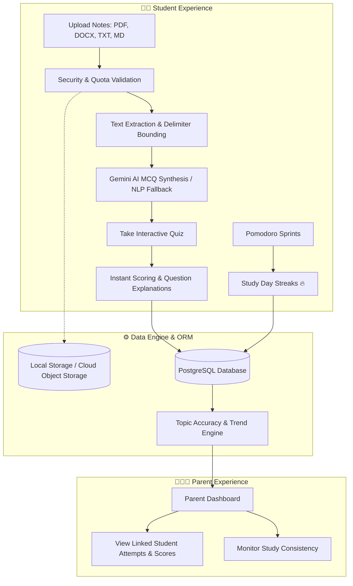

<div align="center">

# 🎓 StudyGrade
### AI-Powered Active Recall, Spaced Flashcards & Student Mastery

[](https://studygrade.onrender.com)
[](https://www.python.org/)
[](https://www.djangoproject.com/)
[](https://www.postgresql.org/)
[](https://getbootstrap.com/)
[](LICENSE)

**Turn lecture notes and educational documents into AI-powered active recall quizzes, interactive flashcards, Pomodoro focus blocks, and measurable parent-visible progress.**

[Live Demo](https://studygrade.onrender.com) · [Features](#-core-capabilities) · [User Journeys](#-user-journeys) · [REST API](#-restful-api-v1) · [Quick Start](#-quick-start) · [Deployment](#-render-production-deployment)

</div>

---

## 📖 About StudyGrade

**StudyGrade** is a full-stack educational mastery platform built with **Python 3.13**, **Django 6.0.5**, and modern AI models. It bridges the gap between passive reading and active comprehension by transforming raw study notes into interactive learning modules.

Students upload course documents (PDF, DOCX, TXT, or Markdown), synthesize key concepts into custom multiple-choice quizzes, test retention with spaced digital flashcards, and run timed Pomodoro study sessions. Parents access a dedicated portal to observe their child's consistency, quiz scores, and subject mastery over time.

---

## ✨ Core Capabilities

| | Feature | Highlights |
|---|---|---|
| 🤖 | **AI Quiz Synthesis** | Generates 5 to 30 grounded MCQs with detailed explanations, difficulty tags, and citations using Gemini models (`gemini-3.5-flash-lite`, `gemini-3.8-flash`, etc.) with automatic cloze-deletion NLP fallback. |
| 🗂️ | **Interactive Flashcards** | Generates interactive front-and-back study decks with 3D flip animations and spaced study tracking. |
| ⏱️ | **Pomodoro Focus Studio** | 25-minute deep work intervals with break cycles and automatic daily study streak incrementing. |
| 📊 | **Topic Mastery & Analytics** | Visualizes topic-level accuracy percentages and recommends focus areas for revision. |
| 🔐 | **Role-Based Portals** | Isolated, secure workspaces for **Students** and linked **Parents** with server-side ownership checks. |
| 🛡️ | **Document Security Pipeline** | Server-side validation of file signatures, encrypted PDF detection, scanned PDF OCR warning, UUID path obfuscation, and per-user storage quotas. |
| 🔌 | **RESTful API (`/api/v1/`)** | Authenticated JSON endpoints for streaks, notes, analytics, and flashcards. |
| 📱 | **Responsive Design** | High-contrast Obsidian & Ember design system built on Bootstrap 5.3 with WhiteNoise compression. |

---

## 🔄 Architecture & Workflow



---

## 🔌 RESTful API (v1)

All endpoints return a standardized JSON envelope:
- **Success:** `{"status": "success", "message": "...", "data": {...}}`
- **Error:** `{"status": "error", "code": "ERROR_CODE", "message": "..."}`

| Method | Endpoint | Access | Purpose |
|---|---|---|---|
| `GET` | `/api/v1/health/` | Public | Service health probe for load balancers |
| `GET` | `/api/v1/streak/` | Authenticated | Active student study streak count |
| `GET` | `/api/v1/analytics/` | Authenticated | Topic accuracy and recommended review areas |
| `POST` | `/api/v1/pomodoro/complete/` | Authenticated | Log a completed focus block |
| `GET` | `/api/v1/notes/` | Authenticated | List all uploaded notes for the student |
| `GET` | `/api/v1/notes/<id>/flashcards/` | Authenticated | Retrieve flashcard deck for a note |

---

## 🧰 Tech Stack & Compatibility

- **Backend**: Python 3.13.7, Django 6.0.5, Django ORM
- **Database**: PostgreSQL (Production) / SQLite (Local development)
- **Security**: Python-Decouple, HSTS, Secure Cookies, CSRF Protection, Server-Side Ownership Controls
- **File Validation & Parsing**: PyPDF2 3.0.1 (PDFs), XML/Zipfile (DOCX), Python built-ins (TXT, Markdown)
- **Object Storage**: `django-storages` with `boto3` (AWS S3, Cloudflare R2, MinIO)
- **AI Integration**: Google GenAI SDK (`google-genai==1.75.0`), Gemini models with multi-model fallback & cloze NLP
- **Static Assets**: WhiteNoise with `SafeWhiteNoiseStorage` (gzip/brotli compression, lenient hash fallback)
- **WSGI Server**: Gunicorn 23.0.0
- **Frontend**: HTML5, CSS3, Bootstrap 5.3.3, Bootstrap Icons, Space Grotesk & Inter typography

---

## 🚀 Quick Start (Local Development)

### 1. Clone the Repository
```bash
git clone https://github.com/Sayali283/StudyGrade.git
cd StudyGrade
```

### 2. Create & Activate Virtual Environment
```bash
# Windows (PowerShell)
python -m venv venv
.\venv\Scripts\Activate.ps1

# macOS / Linux
python3 -m venv venv
source venv/bin/activate
```

### 3. Install Dependencies
```bash
pip install -r requirements.txt
```

### 4. Configure Environment Variables
Copy `.env.example` to `.env`:
```bash
cp .env.example .env
```
For local development, the default `.env` settings enable SQLite and development keys automatically:
- `DEBUG=True`
- `USE_SQLITE=True`
- `GEMINI_API_KEY=` (Optional: add your key from [Google AI Studio](https://aistudio.google.com/))

### 5. Run Migrations & Start Server
```bash
python manage.py migrate
python manage.py runserver
```
Visit **[http://127.0.0.1:8000](http://127.0.0.1:8000)** in your browser!

---

## 🧪 Running Automated Tests

StudyGrade features an extensive automated test suite covering security authorization, upload validation, storage quotas, AI generation with mocking, and analytics:

```bash
python manage.py test
```

To run system and deployment security checks:
```bash
python manage.py check
python manage.py check --deploy
```

---

## 📁 Repository Structure

```text
StudyGrade/
├── core/                           # Primary Django domain application
│   ├── api/                        # RESTful API routing and views (/api/v1/)
│   ├── migrations/                 # Committed database migrations
│   ├── services/                   # Business logic layer
│   │   ├── analytics_service.py    # Topic performance & recommendations
│   │   ├── document_service.py     # Document validation & text extraction
│   │   ├── flashcard_service.py    # AI synthesis & heuristic flashcards
│   │   ├── quiz_service.py         # Gemini AI MCQ synthesis & cloze fallback
│   │   └── streak_service.py       # Active day streak tracking
│   ├── templates/                  # Django templates
│   │   ├── components/             # Reusable UI partials (navbar, footer, alerts)
│   │   └── ...                     # Portal pages (dashboards, quizzes, notes)
│   ├── forms.py                    # Server-side validation forms (NotesForm)
│   ├── models.py                   # Relational ORM models (Student, Quiz, Question, Notes)
│   ├── storage.py                  # Lenient WhiteNoise storage handler
│   ├── tests.py                    # Automated test suites (36 unit/integration tests)
│   └── views/                      # Modular HTTP views (auth, notes, quiz, flashcards)
├── smartstudy/                     # Project configuration
│   ├── settings.py                 # Hardened environment settings
│   ├── urls.py                     # Root URL routing
│   └── wsgi.py                     # WSGI application entrypoint
├── static/                         # CSS stylesheets, JavaScript & SVG assets
├── staticfiles/                    # Compiled assets for WhiteNoise
├── build.sh                        # Production build script for Render
├── render.yaml                     # Infrastructure as Code specification
├── requirements.txt                # Pinned production dependencies
└── runtime.txt                     # Target Python runtime (python-3.13.7)
```

---

## 🛡️ Security & Document Validation Pipeline

1. **Production Safety Defaults**:
   - `DEBUG` defaults strictly to `False`.
   - `SECRET_KEY` requires an explicitly configured, strong key (50+ characters) in production and fails fast if missing.
   - Production requires PostgreSQL (`DATABASE_URL`) and refuses to silently use ephemeral SQLite.

2. **Uploaded Document Security**:
   - **Supported Formats**: Only PDF (`.pdf`), Word (`.docx`), Plain Text (`.txt`), and Markdown (`.md`) are accepted.
   - **File Signature Inspection**: Magic bytes are verified (`%PDF-` for PDFs, `PK` for DOCX).
   - **Password-Protected Documents**: Encrypted PDFs are detected and rejected with a student-friendly explanation.
   - **Scanned PDF Handling**: Detects documents containing no extractable text and informs students that OCR is required.
   - **Path Traversal Protection**: Uploaded files are stored with random UUID filenames (`notes/<uuid>.<ext>`), preventing path traversal and file collisions.
   - **Per-User Storage Quota**: Uploads are restricted to 10 MB per document and 50 MB total per student account.
   - **Automatic Cleanup**: Deleting a note automatically removes its physical file from storage via a Django `post_delete` signal.

3. **Authorization & IDOR Protection**:
   - Object-level ownership is verified on the server for all note viewing, quiz taking, submission, flashcard studying, and deletion.
   - Parents can only access records belonging to their explicitly linked child.
   - Anonymous requests to protected portals are safely redirected to the login page.

4. **AI Reliability & Prompt Delimiting**:
   - Student notes are bounded within `<STUDY_NOTES>` tags with explicit prompt boundaries to mitigate prompt injection.
   - Generated questions are strictly validated for required fields, exactly 4 unique choices, answer correspondence, explanations, and difficulty ratings.
   - Malformed or incomplete questions are quarantined and topped up via intelligent cloze-deletion NLP fallback.
   - Students can report ambiguous or incorrect questions directly from the results view.

---

## ☁️ Production File Storage

### Ephemeral Filesystem vs. Object Storage
On cloud platforms like Render's free tier, the local filesystem is **ephemeral**: files stored on disk are wiped whenever the application redeploys or restarts.
- **Database Persistence**: PostgreSQL safely persists student profiles, quiz records, flashcards, and note metadata across deployments.
- **Document File Persistence**:
  - For local development, files are stored in `media/` via `FileSystemStorage`.
  - For production, StudyGrade supports private S3-compatible **Cloud Object Storage** (AWS S3, Cloudflare R2, Supabase Storage, or MinIO).

To enable cloud object storage in production, set these environment variables:
```env
USE_S3_STORAGE=True
AWS_STORAGE_BUCKET_NAME=your-bucket-name
AWS_ACCESS_KEY_ID=your-access-key-id
AWS_SECRET_ACCESS_KEY=your-secret-access-key
AWS_S3_REGION_NAME=us-east-1
# For Cloudflare R2 or MinIO:
# AWS_S3_ENDPOINT_URL=https://<account_id>.r2.cloudflarestorage.com
```

---

## 🚀 Render Production Deployment

### 1. Automatic Deployment via Blueprint (`render.yaml`)
1. Fork or push the repository to GitHub.
2. In the [Render Dashboard](https://dashboard.render.com/), click **New** > **Blueprint**.
3. Connect your GitHub repository. Render will automatically parse `render.yaml`, provision a managed PostgreSQL database, and build the web service using `build.sh`.

### 2. Required Production Environment Variables
Set these variables in your Render service dashboard under **Environment**:

| Variable | Recommended Production Value | Description |
|---|---|---|
| `DEBUG` | `False` | Disables debug mode in production |
| `SECRET_KEY` | *(Generate via Render or python secrets)* | 50+ character random secret key |
| `ALLOWED_HOSTS` | `studygrade.onrender.com,.onrender.com` | Allowed incoming HTTP hostnames |
| `CSRF_TRUSTED_ORIGINS` | `https://studygrade.onrender.com,https://*.onrender.com` | Trusted HTTPS origins for POST requests |
| `DATABASE_URL` | *(Automatically linked from PostgreSQL service)* | Managed PostgreSQL connection string |
| `GEMINI_API_KEY` | *(Your Google AI Studio API key)* | Enables AI quiz and flashcard synthesis |
| `USE_S3_STORAGE` | `True` *(when object storage bucket is configured)* | Enables cloud object storage persistence |
| `AWS_STORAGE_BUCKET_NAME` | *(Your S3 or R2 bucket name)* | Object storage bucket name |
| `AWS_ACCESS_KEY_ID` | *(Your storage access key)* | Object storage access credentials |
| `AWS_SECRET_ACCESS_KEY` | *(Your storage secret key)* | Object storage secret credentials |

---

## ⚠️ Known Limitations & Manual Setup Actions

1. **Scanned PDF OCR**:
   - The application extracts selectable text from PDF, DOCX, TXT, and Markdown files.
   - Image-only scanned PDFs require optical character recognition (OCR). The system detects scanned documents and prompts the student to upload notes containing selectable text.
2. **Gemini API Key**:
   - You must obtain an API key from [Google AI Studio](https://aistudio.google.com/) and configure `GEMINI_API_KEY` in the Render dashboard. If absent, the built-in cloze NLP extractor continues to generate quizzes without interruption.
3. **External Object Storage**:
   - If persistent storage for original uploaded PDF files across Render container restarts is needed, configure an S3-compatible bucket (e.g. Cloudflare R2 provides a free 10GB tier) and provide the credentials listed above.
4. **Secret Key Rotation**:
   - Never commit `.env` or production credentials to Git history. If any key is ever compromised, rotate it immediately in the external provider dashboard.

---

## 👩‍💻 Author

**Sayali Ingole**  
*Python · AI/ML · Full-Stack Development*

[](https://github.com/Sayali283)
[](https://www.linkedin.com/in/sayali-ingole-bb0ab3295)

---

<div align="center">

⭐ If you find StudyGrade helpful, consider giving it a star on GitHub!

</div>
