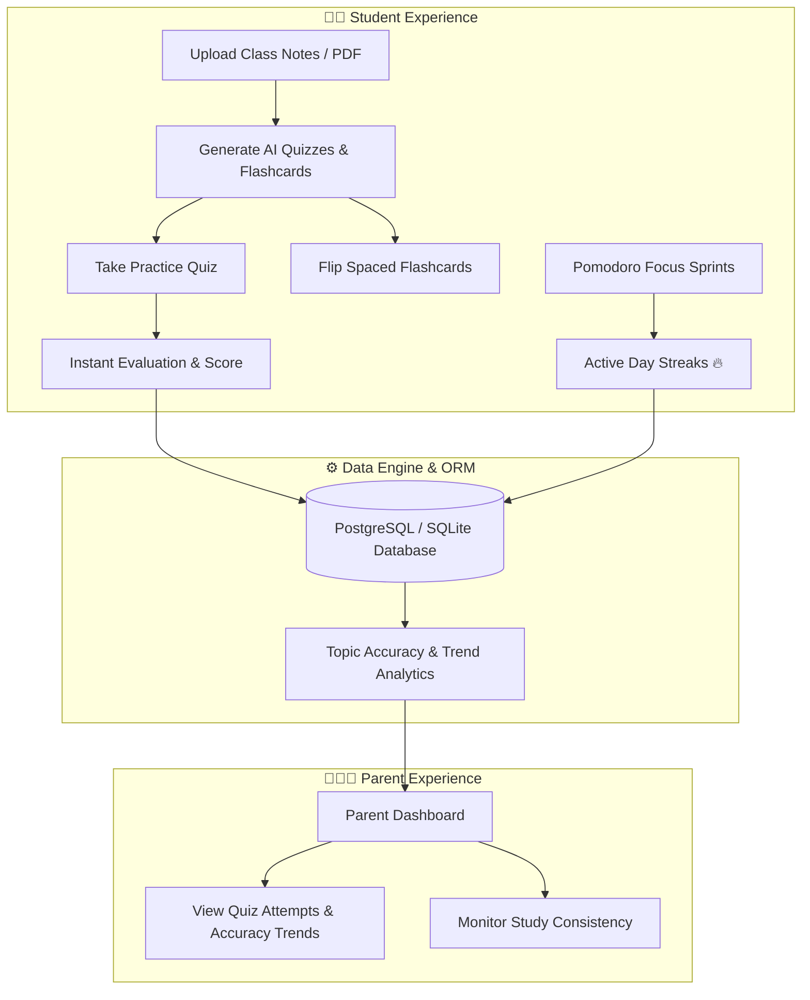

<div align="center">

# 🎓 StudyGrade
### AI-Powered Active Recall, Spaced Flashcards & Student Mastery

[](https://studygrade.onrender.com)
[](https://www.python.org/)
[](https://www.djangoproject.com/)
[](https://www.postgresql.org/)
[](https://getbootstrap.com/)
[](LICENSE)

**Turn lecture notes and PDFs into AI-powered active recall quizzes, interactive flashcards, Pomodoro focus blocks, and measurable parent-visible progress.**

[Live Demo](https://studygrade.onrender.com) · [Features](#-core-capabilities) · [User Journeys](#-user-journeys) · [REST API](#-restful-api-v1) · [Quick Start](#-quick-start) · [Architecture](#-architecture--workflow)

</div>

---

## 📖 About StudyGrade

**StudyGrade** is a full-stack educational platform built with **Django** and powered by AI intelligence. It helps students transition from passive reading to active mastery. 

Students can drop lecture notes (PDFs, DOCX, or text files), synthesize key learning points into multiple-choice quizzes, flip spaced-repetition flashcards, and run Pomodoro study sprints. Parents get dedicated oversight dashboards to track their student's consistency, quiz accuracy, and topic weak spots.

---

## ✨ Core Capabilities

| | Feature | Highlights |
|---|---|---|
| 🤖 | **AI Quiz Synthesis** | Converts uploaded class notes and PDFs into 5 to 30 custom MCQs to test comprehension. |
| 🗂️ | **Interactive Flashcards** | Generates front-and-back digital flashcards with flip animations and spaced study tracking. |
| ⏱️ | **Pomodoro Focus Timer** | 25-minute deep work sprints with break cycles and automatic daily study streak incrementing. |
| 📊 | **Topic Mastery & Analytics** | Visualizes accuracy percentages across topics and pinpoints areas needing revision. |
| 🔐 | **Role-Based Workspaces** | Independent, authenticated portals for **Students** and linked **Parents**. |
| 🔌 | **RESTful API (`/api/v1/`)** | Clean JSON endpoints for streak analytics, notes access, and mobile or external clients. |
| 📱 | **Responsive Design** | Custom dark/light styling built on Bootstrap 5 with WhiteNoise compression. |

---

## 🔄 Architecture & Workflow



---

## 🧭 User Journeys

### 1. Student Workflow
1. **Sign Up & Personalize**: Register with semester and class details.
2. **Upload Notes**: Drop subject notes in PDF or TXT format.
3. **Practice**:
   - Generate active recall MCQs with customized question counts.
   - Flip flashcards for quick revision before exams.
4. **Focus & Streak**: Complete 25-minute Pomodoro sessions to maintain study streaks.
5. **Analyze**: Review weak topics on the progress dashboard.

### 2. Parent Workflow
1. **Link Account**: Register a parent account by providing the registered student's email.
2. **Monitor**: Access the parent dashboard to view:
   - Recent quiz scores and timestamps.
   - Overall topic accuracy rates.
   - Daily active study streaks.

---

## 🔌 RESTful API (v1)

StudyGrade includes standardized JSON API endpoints mounted under `/api/v1/`:

| Method | Endpoint | Access | Purpose |
|---|---|---|---|
| `GET` | `/api/v1/health/` | Public | Service health probe |
| `GET` | `/api/v1/streak/` | Authenticated | Active student study streak count |
| `GET` | `/api/v1/analytics/` | Authenticated | Topic accuracy and recommended review areas |
| `POST` | `/api/v1/pomodoro/complete/` | Authenticated | Log a completed focus block |
| `GET` | `/api/v1/notes/` | Authenticated | List all uploaded notes for the student |
| `GET` | `/api/v1/notes/<id>/flashcards/` | Authenticated | Retrieve flashcard deck for a note |

---

## 🧰 Tech Stack

- **Backend**: Python 3.11+, Django 5.2, Django ORM
- **Database**: PostgreSQL (Production) / SQLite (Local development)
- **Frontend**: HTML5, CSS3, Bootstrap 5.3, Bootstrap Icons, JavaScript
- **Static Assets**: WhiteNoise storage with gzip/brotli manifest compression
- **AI Integration**: Gemini API for intelligent note parsing and quiz generation
- **Hosting / CI/CD**: Render, Gunicorn WSGI, GitHub Actions

---

## 🚀 Quick Start

### 1. Clone the Repository
```bash
git clone https://github.com/Sayali283/StudyGrade.git
cd StudyGrade
```

### 2. Create & Activate Virtual Environment
```bash
# Windows
python -m venv venv
.\venv\Scripts\Activate.ps1

# macOS / Linux
python3 -m venv venv
source venv/bin/activate
```

### 3. Install Dependencies
```bash
pip install -r requirements.txt
```

### 4. Configure Environment Variables
Copy `.env.example` to `.env`:
```bash
cp .env.example .env
```
Fill in your settings (`SECRET_KEY`, `GEMINI_API_KEY`, etc.). For local SQLite development, no extra database configuration is required.

### 5. Run Migrations & Start Server
```bash
python manage.py migrate
python manage.py runserver
```

Open **[http://127.0.0.1:8000](http://127.0.0.1:8000)** in your browser!

---

## 🧪 Running Tests

StudyGrade features a comprehensive test suite covering authentication, quiz submission, models, and analytics:

```bash
python manage.py test
```

---

## 📁 Clean Repository Structure

```
StudyGrade/
├── .github/workflows/   # CI automation
├── core/                # Core Django application
│   ├── api/             # RESTful API routing and views
│   ├── migrations/      # Database migrations
│   ├── services/        # Business logic (streaks, analytics)
│   ├── templates/       # HTML templates (Django templating)
│   └── views/           # Modular authentication, quiz, note views
├── smartstudy/          # Project configuration (settings, URLs, WSGI)
├── static/              # CSS stylesheets, JavaScript & SVG logos
├── build.sh             # Production build script
├── manage.py            # Django CLI utility
├── Procfile             # Render process declaration
├── render.yaml          # Infrastructure as Code specification
├── requirements.txt     # Python production dependencies
└── runtime.txt          # Python runtime specification
```

---

## 🔐 Security & Reliability

- **CSRF & Session Security**: Robust cross-site request forgery and cookie protections.
- **Protected Routing**: Granular access control for student and parent namespaces with automatic redirect preservation.
- **REST Error Standards**: Authenticated JSON responses returning standard `401 Unauthorized` and `403 Forbidden` statuses.
- **Secret Isolation**: Configuration loaded strictly via environment variables with `python-decouple`.

---

## 👩‍💻 Author

**Sayali Ingole**  
*Python · AI/ML · Full-Stack Development*

[](https://github.com/Sayali283)
[](https://www.linkedin.com/in/sayali-ingole-bb0ab3295)

---

<div align="center">

⭐ If you find StudyGrade helpful, consider giving it a star on GitHub!

</div>
